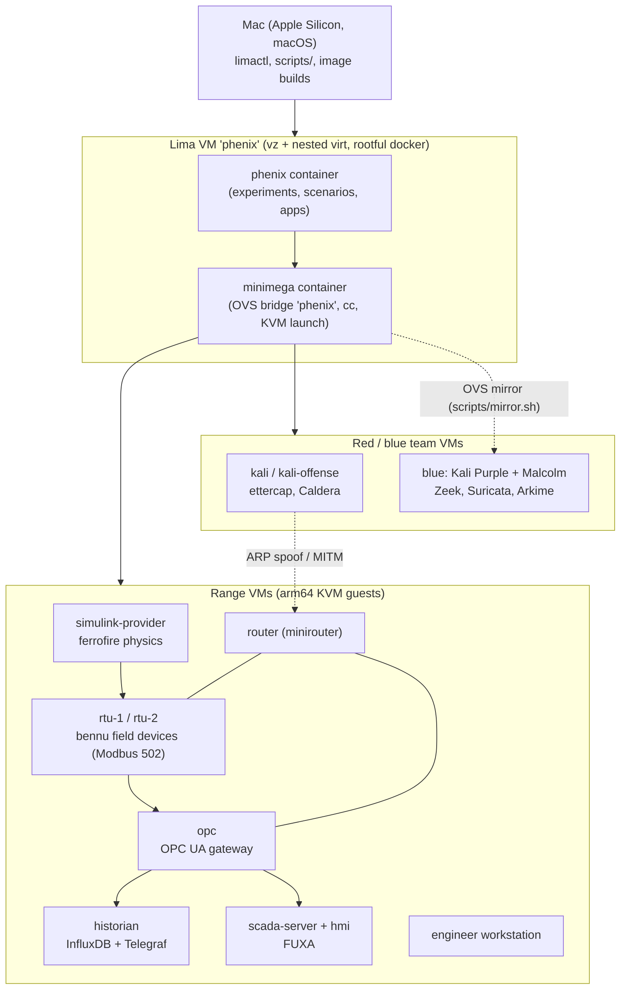
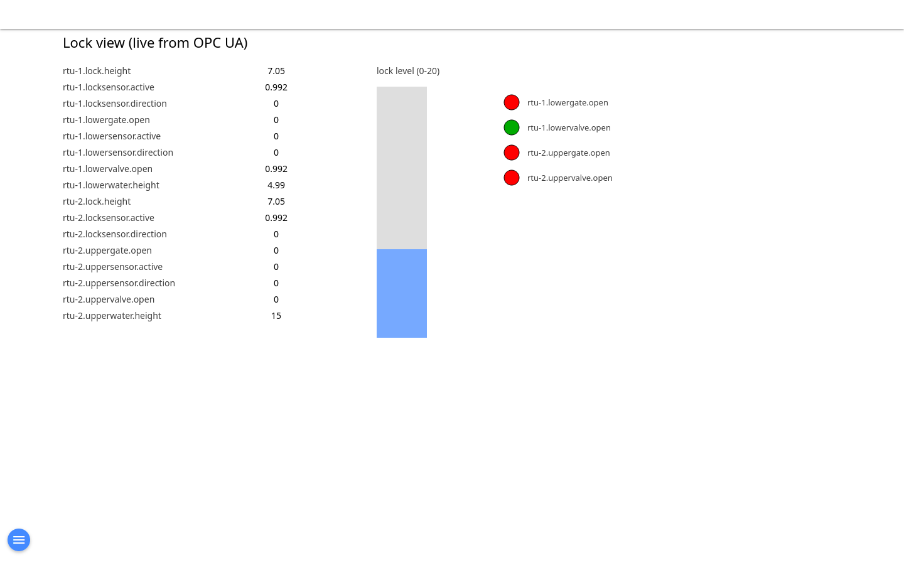
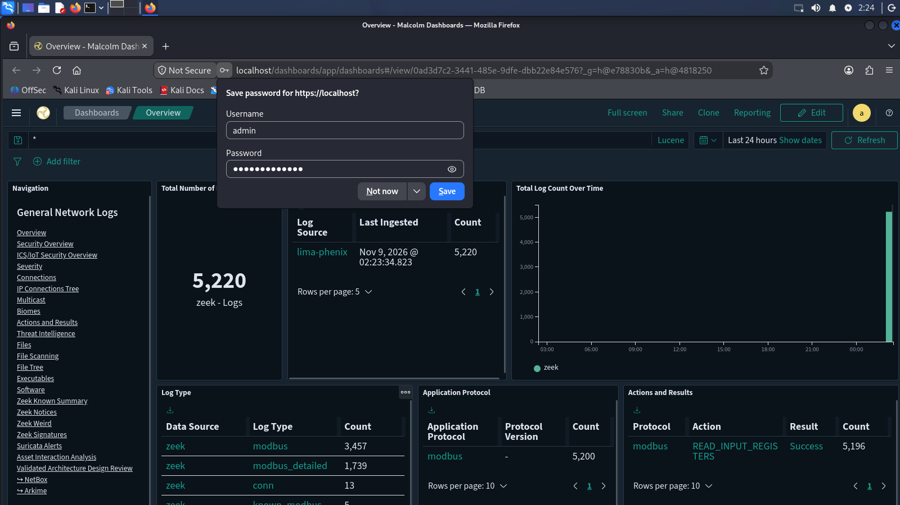
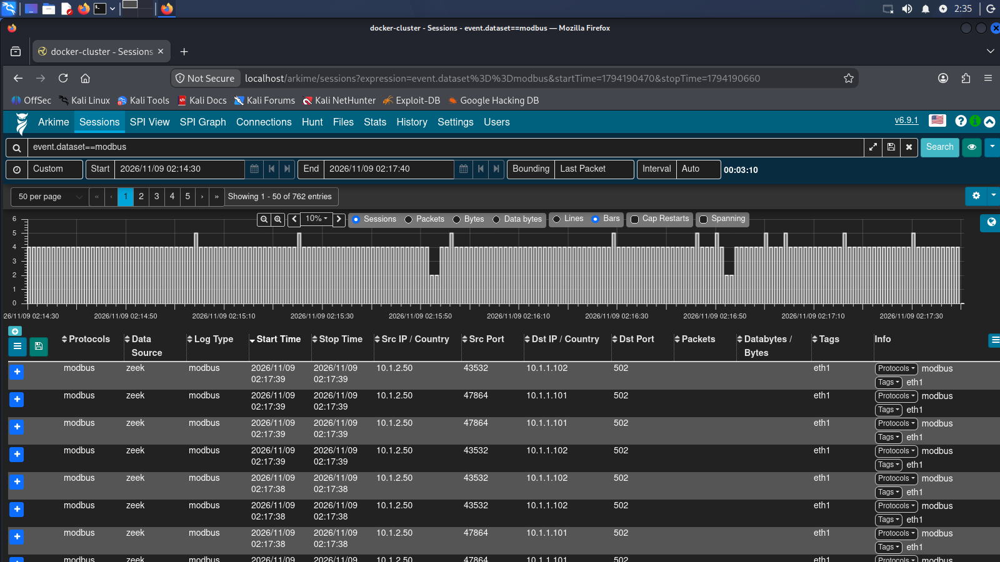
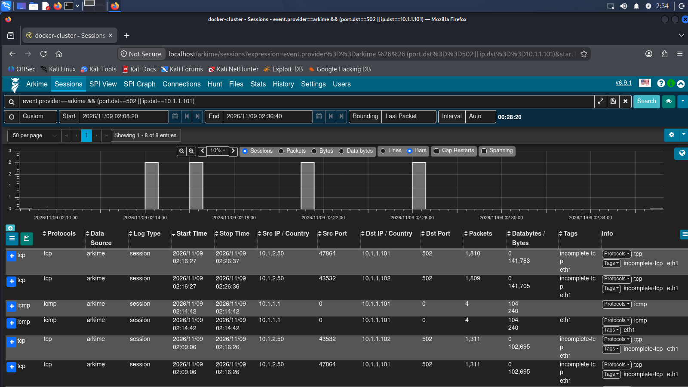

# phenix-waterway-range

SCEPTRE / phenix waterway lock range on Apple Silicon. arm64 guests run under nested KVM inside a Lima VM; no x86 emulation of the range itself.

## What we are doing

We run a model river lock as a small, repeatable ICS range and attack and defend it. Three pieces make that work:

- **A simple provider.** One process simulates the lock physics (15 tags) and nothing else. It is `simulinksolver`, built from [ferrofire](https://github.com/adamsrnmsu/ferrofire), run behind the stock `bennu-simulink-provider`. It publishes the current tag values and accepts writes; everything else on the range reads and writes through it.
- **bennu, which is the field-device layer.** A field device (RTU, PLC) is a box that holds a process's I/O points and serves them to a master over an ICS protocol. `bennu-field-device` does exactly that: it takes the provider's tag values and exposes them as a Modbus, DNP3 or IEC 60870-5-104 server, and turns a master's writes back into provider writes. The two RTU VMs run it, so SCADA, the OPC gateway and the attacker's tools see ordinary Modbus devices whose values come from the simulation.
- **A bennu update.** Because bennu is the part that parses bytes from the network, it is also the part an attacker or a flaky client reaches first. Our update is [sceptre-bennu #81](https://github.com/sandialabs/sceptre-bennu/pull/81), alongside the earlier fd-leak fix #79: the servers now drop a truncated or oversized Modbus request instead of answering it from a stale buffer, the DNP3 outstation keeps accepting after an `accept()` error, and the IEC-104 server keeps polling the active master when other clients connect. The arm64 build of bennu and the live checks that exercise these cases on this range live in [everything-burger-with-extra-sauce](https://github.com/adamsrnmsu/everything-burger) (boards `fdleak` and `robust`).

## What it is

- A [phenix](https://github.com/sandialabs/sceptre-phenix) + minimega testbed that models a river lock (the "waterway"): physics provider, two RTUs, OPC UA gateway, historian, SCADA/HMI, engineer workstation, router.
- Runs on an M3+ Mac: Lima VM `phenix` (vz, nested virtualization, rootful docker) hosts the `minimega` and `phenix` containers, which launch arm64 KVM guests.
- Includes blue/red team add-ons: Kali, Kali Purple + Malcolm (Zeek/Suricata/Arkime), Caldera, and an Ignition (trial) gateway.
- Physics comes from [ferrofire](https://github.com/adamsrnmsu/ferrofire) (Rust `simulinksolver`, see `provider/`).
- Design and decisions: `docs/plan.md`. Work tracking: beads (`bd`) in `.beads/`.

## Architecture



## Quick start

```bash
limactl start phenix        # lima/phenix.yaml
make -C docker              # first time: builds minimega + phenix containers (run inside the VM, see section 1)
images/build.sh bennu-arm64 # and the other images, see the table below
```
Then follow the numbered operating guide below (start the range, verify a boat transit).

## Images

Recipes live in `images/recipes/*.env` (format: `images/recipes/README.md`); install scripts in `images/scripts/`. Build with `images/build.sh <name>`; output `/phenix/images/<name>.qc2`.

| Recipe | Base | Contents |
| --- | --- | --- |
| `bennu-arm64` | Ubuntu jammy | SCEPTRE bennu (RTU / provider runtime), vendored arm64 build |
| `minirouter-arm64` | Ubuntu noble | phenix minirouter: OVS, bird, dnsmasq, nftables |
| `opc-arm64` | noble | Linux OPC UA gateway (Modbus master to RTUs) |
| `scada-arm64` | noble | FUXA SCADA server |
| `historian-arm64` | noble | InfluxDB 2 + Telegraf (OPC UA input) |
| `hmi-arm64` | noble + XFCE | FUXA lock HMI in a kiosk browser |
| `engineer-arm64` | noble + XFCE | engineer workstation |
| `kali-arm64` | kali-rolling | attacker box with ettercap (MITM) |
| `kali-offense-arm64` | kali-rolling + XFCE | offensive desktop |
| `kali-purple-arm64` | kali-rolling + XFCE | blue-team VM running Malcolm (Zeek, Suricata, Arkime); 80 GiB disk |
| `caldera-arm64` | noble + XFCE | MITRE Caldera 5.2.0 with OT plugins |
| `ignition-arm64` / `ignition-amd64` | noble | Inductive Automation Ignition gateway (trial mode) |
| `ubuntu-arm64` / `ubuntu-amd64` | noble | plain base images |

## Topologies

| Topology | Purpose |
| --- | --- |
| `topologies/waterway-arm64` | the full lock range (generated by `gen_topology.py`, `gen_scenario.py`, `scada/gen_configs.py`) |
| `topologies/mitm-arm64` | waterway subset plus attacker `kali` and optional `blue` capture VM; MITM scenario via `scorch`/ettercap (`gen_mitm.py`) |
| `topologies/blue-test` | blue-team VM smoke test |
| `topologies/ign-test` | Ignition gateway on arm64 / amd64 |
| `topologies/caldera-test`, `kali-offense-test`, `helloworld-arm64`, `phase2..4` | per-image and bring-up tests |

## Evidence

- MITM: ettercap ARP spoof between router, rtu-1 and the OPC gateway, captured and analyzed (`docs/mitm-evidence.md`, `docs/mitm-capture.pcap`, `scripts/pcap_walkthrough.py`).
- Malcolm detection: the `ArpSpoof` Zeek script and Suricata ICS rules (`images/malcolm-zeek`, `images/malcolm-suricata`) raise live notices during the attack (`docs/blue-evidence.md`).
- HMI and tool screenshots: `docs/shots/`.

| FUXA lock HMI | Malcolm overview |
| --- | --- |
|  |  |

| Zeek Modbus | Arkime sessions |
| --- | --- |
|  |  |

## Evidence capture (Playwright)
`scripts/evidence/run_all.sh` regenerates the screenshots/GIFs in `docs/shots/playwright/` (idempotent). Playwright runs in the
`mcr.microsoft.com/playwright/python:v1.49.0-noble` container and GIFs are made with `lscr.io/linuxserver/ffmpeg`; nothing is installed on the Mac.
Needs: Docker, the Lima VM + `waterway` experiment running, parseus on `:8080` (State tab needs sandialabs/parseus#6), Kibana `:5601` with data view
`parseus-zeek`, phenix UI `:3000`. Override with `PARSEUS_URL` / `KIBANA_URL` / `PHENIX_URL`, or `ONLY=a,b,c,d ./scripts/evidence/capture.sh` for one flow.
Output: `registers-chart.{png,gif}`, `state-tab.png`, `kibana-dnp3-points.png`, `kibana-dnp3-chart.png` (creates saved Vega vis `dnp3-rtu1-values`), `phenix-waterway.png`, `hmi-transit.gif` (`hmi_gif.sh`, ~60 s of `mm vm screenshot hmi`).

## Related

- [ferrofire](https://github.com/adamsrnmsu/ferrofire): the physics engine behind `provider/waterway-sim`.
- Upstream PR drafts: `docs/upstream/`.

## Licensing

- This repository: MIT (`LICENSE`).
- Third-party software installed into images is not covered by that license and keeps its own: Malcolm, Zeek, Suricata, Arkime, Caldera, FUXA, Kali Linux, InfluxDB, Telegraf, bennu/phenix/minimega (Sandia), Ubuntu packages.
- Ignition (Inductive Automation) runs in trial mode; the operator accepts the Ignition EULA. No Ignition binaries are in this repo.

## Known limits

- Apple M3 or newer only (nested virtualization via vz); needs roughly 80 GiB RAM for the full range plus blue team.
- Headless guests have no display unless the topology adds `virtio-gpu-pci` (already set for GUI nodes).
- Malcolm needs ~10-15 min to be healthy after boot; the OVS mirror is not persistent (re-run `scripts/mirror.sh` after every `px exp start`).
- `ignition-amd64` is an x86 guest; on arm64 it can only run under TCG emulation and is slow.
- All credentials are lab defaults (see below); do not expose the range to untrusted networks.
- Image artifacts (`*.qc2`, the 540 MB bennu overlay, the built `simulinksolver`) are not in git; rebuild them.

## Credentials (lab defaults, documented)

| Where | Value | Note |
| --- | --- | --- |
| Malcolm web | `admin` / `MalcolmBlue1!` | blue VM, self-signed cert |
| Kali / Kali Purple console | `root` / `toor` | Kali convention |
| bennu image | `root:SiaSd3te`, `sceptre:sceptre` | upstream SCEPTRE defaults |
| Ignition gateway | `admin` / `password` | range default |
| InfluxDB | `admin` / `waterway-admin-pass`, token `waterway-historian-token` | range-local historian |
| Caldera test config | `ADMIN123`, `BLUEADMIN123`, `s4ndc4t!` | Caldera stock defaults |

# Operating guide


## 1. Start the VM and containers
```bash
limactl start phenix            # lima/phenix.yaml; ~/git mounted at the same path, /phenix/images is a data disk
limactl shell phenix sudo docker ps          # minimega + phenix (restart: always, so they come back with the VM)
# first time / after docker/ changes:  limactl shell phenix -- sudo make -C ~/git/phenix-waterway-range/docker   (builds minimega + phenix, `up`)
```
Handy aliases (the phenix CLI lives in the container):
```bash
px() { limactl shell phenix sudo docker exec phenix phenix "$@"; }
mm() { limactl shell phenix sudo docker exec minimega mm "$@"; }
```

## 2. Images (once)
`images/build.sh <name>` for `bennu-arm64 minirouter-arm64 opc-arm64 scada-arm64 historian-arm64 hmi-arm64 engineer-arm64`
(recipes in `images/recipes/`, results in `/phenix/images/*.qc2`). Builds are serialized with `flock /tmp/phenix-image-build.lock`.
Provider physics: `cd provider/waterway-sim && ./build-linux.sh` (Rust `simulinksolver`, stock `bennu-simulink-provider`),
then `cp dist/simulinksolver topologies/waterway-arm64/injects/`.

## 3. Start the range
```bash
# regenerate (only if the topology/scenario/register map changed)
uv run --with pyyaml python -I topologies/waterway-arm64/gen_topology.py > topologies/waterway-arm64/waterway-topology.yaml
uv run --with pyyaml python -I topologies/waterway-arm64/gen_scenario.py > topologies/waterway-arm64/waterway-scenario.yaml
uv run --with pyyaml --with jinja2 python -I scada/gen_configs.py --topology topologies/waterway-arm64/waterway-topology.yaml
rm -rf ~/phenix/topologies/waterway-arm64 && cp -R topologies/waterway-arm64 ~/phenix/topologies/   # ~/phenix = /phenix/topologies in the VM

px config create /phenix/topologies/waterway-arm64/waterway-topology.yaml
px config create /phenix/topologies/waterway-arm64/waterway-scenario.yaml
px exp create waterway -t waterway-arm64 -s waterway-arm64
px exp start waterway
mm namespace waterway clear cc filter       # a stale cc filter silently swallows `cc exec`
px exp stop waterway                        # repeatable: px exp start waterway again
```
Boot takes ~2 min; `mm namespace waterway cc clients` should list 9 arm64 clients.

**DNP3 variant** (ferrofire field device on rtu-1/rtu-2 serving Modbus 502 + DNP3 20000; the OPC gateway polls over DNP3):
`cd ~/git/ferrofire && make linux && cp dist/ferrofire <repo>/topologies/waterway-arm64/injects/`, rebuild `images/build.sh opc-arm64`
(gateway with dnp3py), then run the generators above with `--dnp3` added to `gen_topology.py`, `gen_scenario.py` and
`gen_configs.py` (`gen_configs.py --from-dry-run <phenix-app-sceptre> --scenario ... --topology ...` first refreshes
`reg_addrs.json` and `reg_addrs_dnp3.json`). `injects/ferrofire-fd-shim.sh` is injected as `bennu-field-deviced` so
`bennu-watcherd` starts ferrofire (log `/var/log/ferrofire-field-device.log`). Without the flags the output is unchanged.

## 4. Verify a boat transit end to end
GUI nodes need `-device virtio-gpu-pci` (already in the topology) for screenshots.
```bash
# exec in a guest:  mm namespace waterway cc filter hostname=rtu-1; mm namespace waterway cc exec bash -c '<cmd>'; mm namespace waterway cc responses all
bennu-probe --e tcp://172.16.1.2:5555 --c read --t lowergate.open     # rtu-1: 0 -> 1 as the boat arrives (poll it)
uaread -u opc.tcp://10.1.2.50:4840 -n 'ns=2;s=rtu-1.lowergate.open'   # opc: agrees
influx query 'from(bucket:"waterway")|>range(start:-5m)|>filter(fn:(r)=>r._measurement=="waterway")|>count()'   # historian
mm vm screenshot hmi /tmp/hmi.png                                     # FUXA lock view (screenshots land in the minimega container)
```
Evidence from the last run is in the notes of bead ww-585.13.

## 5. Blue team: OVS mirror to Kali Purple + Malcolm
`topologies/mitm-arm64` includes a `blue` VM (kali-purple-arm64.qc2, 16 GiB, 6 vCPU; `gen_mitm.py --no-blue` omits it):
eth0 = mgmt (172.16.1.250), eth1 = capture NIC alone on a dedicated `MIRROR` vlan. Malcolm (Zeek/Suricata/Arkime on eth1)
starts at boot and is healthy after ~10-15 min; UI `https://172.16.1.250/` (admin / MalcolmBlue1!, see `images/recipes/README.md`).
minimega puts all VMs on OVS bridge `phenix` (`mega_tapN` ports; each experiment VLAN name gets its own tag, `mm vm info` shows
`vlan`/`tap` per NIC in order). `scripts/mirror.sh` adds an OVS Mirror on that bridge:
```bash
scripts/mirror.sh mitm blue 1          # <experiment> <blue vm> <capture NIC index (0-based)>; run on the Mac or inside Lima
scripts/mirror.sh mitm blue 1 --off    # remove it
```
It mirrors every NIC of the experiment except those on MGMT and the capture VLAN (select_src_port+select_dst_port per tap, because
OVS `select_vlan` does not match traffic from access ports; output-port = blue's capture tap), so packets that cross the router appear
once per segment. Named `mir-<experiment>`; re-running replaces it (idempotent). It is not persistent: OVS ports/mirrors vanish with the
experiment, so re-run it after every `px exp start`. Do not point it at a NIC you need for normal traffic (an OVS
output-port is removed from normal switching). Check: `ovs-vsctl list Mirror` in the minimega container; on blue,
`tcpdump -ni eth1 'tcp port 502 or arp'`.
