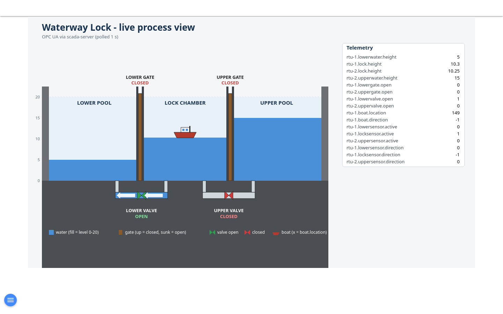
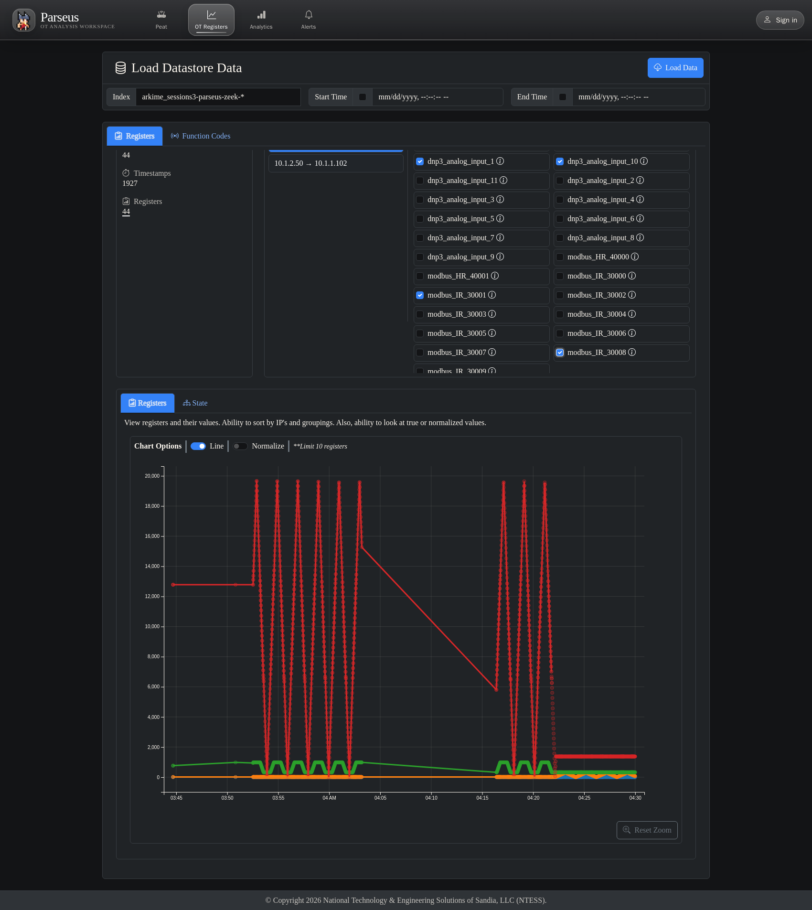
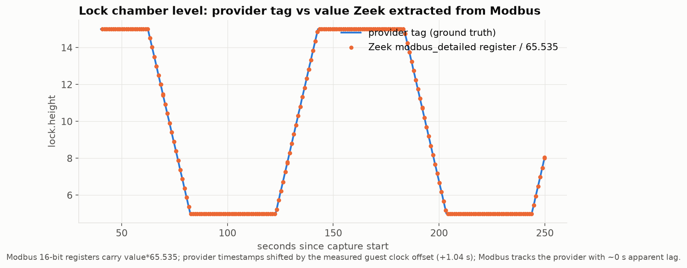
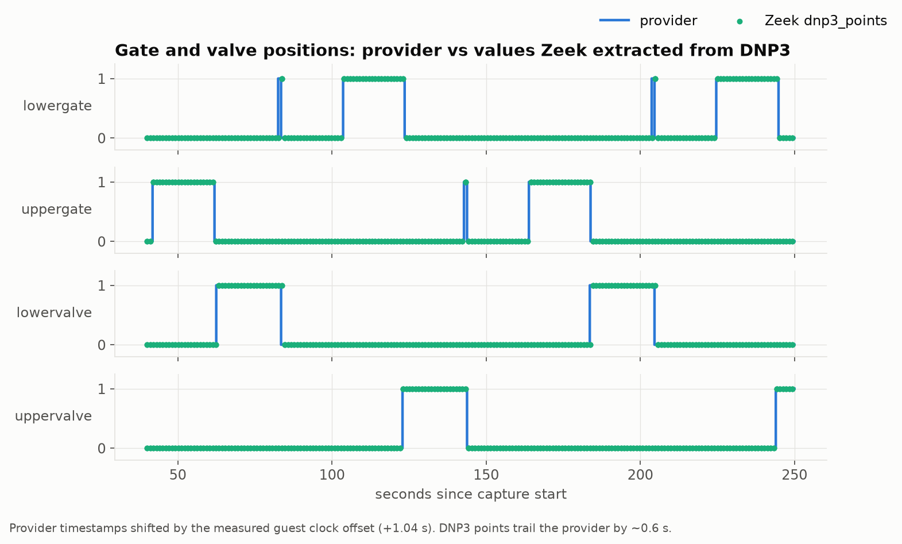
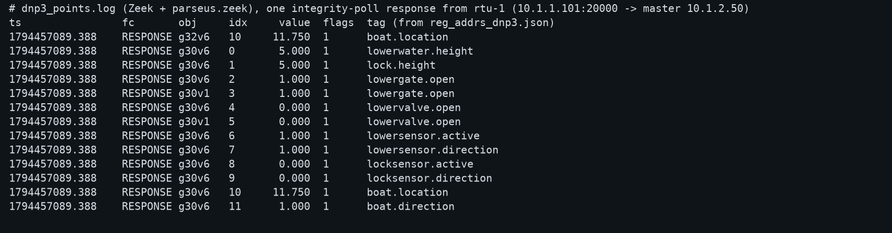
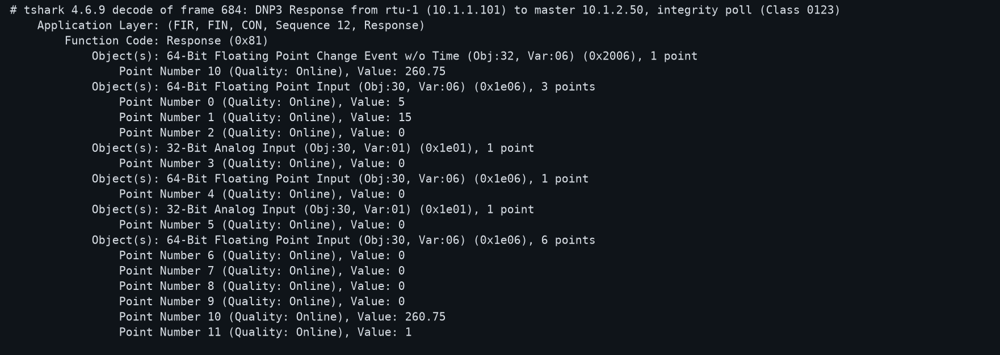

# parseus Zeek DPI on the DNP3 waterway range: evidence

Captured 2026-11-12 on the running `waterway` experiment (ferrofire field devices, OPC gateway polling over DNP3). Full narrative, charts and raw data are in the show-off bundle; this is the short version kept with the repo. Numbers: `docs/dnp3-parseus-stats.json`. Capture: `docs/dnp3-capture.pcap` (629 KiB, 5439 packets, 378 s, about three lock cycles, ICS VLAN only; replay with `deploy/integrations/zeek/scripts/replay_pcap.sh` from parseus).

## How

`VLAN=ICS scripts/mirror.sh waterway port:monitor0 0` mirrors the ICS VLAN (router ICS tap + both RTU taps, so every routed frame once) to an OVS internal port. In the Lima VM: `pz-zeek` (parseus Zeek image, host net, `ZEEK_IFACE=monitor0`) -> `pz-ing` (`python -m parseus.ingestors.zeek`) -> `pz-es` Elasticsearch 8.19.5 on :9205 (security off). The same pcap replayed through the same image/ingestor into a second ES (`pz-es-pcap` :9206). Passive only; no DNP3 master touched an RTU. A light pymodbus FC4 poller (1 Hz per RTU, opc VM) was added because the gateway no longer speaks Modbus.

## Results

| check | result |
|---|---|
| live ingest | docs grow every 2 s; batch arrival delay median 0.715 s, p95 1.389 s |
| live vs pcap | dnp3_points 8169/8169, dnp3 678/678, modbus_detailed 1352/1352 docs, 100% identical records |
| Zeek vs tshark (g30v6) | 6102/6102 identical |
| Zeek Modbus vs client poller | 6084 values, 100% identical |
| Zeek DNP3 vs provider tags | 85.7% exact over 8169 points at lag 0.6 s; discrete tags 98 to 100%; continuous tags within about 0.5 s of travel |
| Zeek Modbus vs provider | lag 0.0 s; lock.height median error 0.0103 |
| DNP3 poll | 678 transactions in 344 s, interval median 1.0107 s, p95 1.0235 s; 8169 points rows (23.775/s), 12/10 points per poll |
| Modbus | 676 request/response pairs, 6084 register values, FC4 only, 0 exceptions |
| cost | Zeek 0.46% CPU / 92 MiB; ingestor 1.0% / 62 MiB |

Found and fixed during the exercise: ferrofire sends analog inputs as g30v6 doubles and g32v6 events; the first capture showed Zeek extracting only the two g30v1 points per RTU (2 of 12) until `parseus.zeek` handled the double-precision events (parseus PR #4, image `parseus-zeek:dpfix`). All results above are from a fresh capture after the fix.

## Method notes and limits

Guest clocks are behind the host (rtu-1 1.04 s, opc 2.88 s; measured with UDP probes, applied to provider/poller samples). Two RTUs at 1 Hz: correctness and cost, not scale. No DNP3 write/operate function codes in the pcap. Modbus direction tags clamp -1 to 0 (unsigned scaling).

## Screenshots (`docs/shots/dnp3/`)

More: `boat-location-provider-vs-dnp3-vs-modbus.png`, `protocol-rates.png`, `poll-interval-hist.png`, `dnp3-extraction-coverage.png`, `parseus-function-codes.png`, `hmi-lower-gate-open.png`, `zeek-modbus_detailed-excerpt.png`. Helper scripts: `docs/showoff-scripts/`.

## Running stack and how to stop it

Lima containers: `pz-es` (:9205), `pz-zeek`, `pz-ing`, `pz-es-pcap` (:9206), `pz-ing-pcap`, `pz-web` (parseus UI, :8085). Stop: `VLAN=ICS scripts/mirror.sh waterway port:monitor0 0 --off` (also deletes the port) then `limactl shell phenix sudo docker rm -f pz-es pz-zeek pz-ing pz-es-pcap pz-ing-pcap pz-web`. After a `--off` + re-enable, `docker restart pz-zeek` (the sniffed interface is recreated; Zeek does not follow it).
